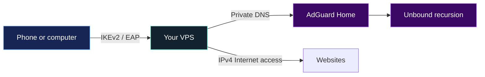

<p align="center">
  
</p>

<h1 align="center">Single VPS VPN Gateway</h1>

<p align="center"><a href="https://github.com/VictorBoykoV/rookstride"></a><br><a href="https://github.com/VictorBoykoV/rookstride">Deploy and manage from Android with Rookstride</a></p>

<p align="center">
  A self-hosted IKEv2 VPN with private DNS ad blocking, built on one VPS.
</p>

<p align="center">
  
  
  
  
  
  <a href="LICENSE"></a>
</p>

<p align="center">
  <a href="#quick-start">Quick start</a> ·
  <a href="#deploy-from-android">Deploy from Android</a> ·
  <a href="#architecture">Architecture</a> ·
  <a href="docs/CLIENTS.md">Client setup</a> ·
  <a href="docs/OPERATIONS.md">Operations</a> ·
  <a href="docs/TESTING.md">Tests</a> ·
  <a href="#security-and-limitations">Security</a>
</p>

A self-hosted VPN on one VPS, using **strongSwan IKEv2/EAP**, **AdGuard Home** for DNS-based ad and tracker blocking, and **Unbound** for recursive DNS. The server's public IPv4 is the address websites see. The template does not assume a provider, country, hostname, or user account.

## Architecture



## What this installs

- strongSwan IKEv2 with a private certificate authority and an initial EAP user.
- IPv4 full-tunnel forwarding and NAT through the VPS, with forwarding restricted to authenticated IPsec traffic.
- An IPv6 tunnel address and a server-side IPv6 sink. AdGuard returns no IPv6 DNS addresses because this gateway has no IPv6 Internet exit. The generated Android profile blocks IPv4 and IPv6 traffic outside the VPN; client behavior still needs a real-device test.
- AdGuard Home on a private VPN-only address. Its dashboard is password-protected and is not bound to the public interface.
- Unbound on localhost as AdGuard's recursive upstream, with no public DNS fallback.
- The [official AdGuard DNS filter](https://github.com/AdguardTeam/HostlistsRegistry) and no per-query history by default.

DNS filtering cannot remove ads served from the same domain as the desired content. Applications with their own encrypted DNS can bypass the VPN's DNS setting. A VPN also cannot hide GPS, account identity, cookies, or device fingerprints.

**YouTube ads:** AdGuard Home cannot reliably remove in-video YouTube ads, and adding more DNS blocklists will not solve that limitation. Keep the server filter for ordinary ads and trackers; use a content blocker in the browser where you watch YouTube, or an official ad-free YouTube subscription for the native app. See [YouTube and client-side blocking](docs/AD-BLOCKING.md) for device-specific options and the Android VPN conflict.

## Requirements

- A **fresh Ubuntu 24.04** VPS with a public IPv4 address and `x86_64` or `aarch64` CPU. The installer refuses an existing strongSwan/AdGuard setup.
- Root or sudo access, outbound HTTPS for downloads, and outbound DNS for Unbound recursion.
- Provider firewall access: allow inbound **UDP 500 and 4500**. Keep SSH open for administration. Do not expose TCP/UDP 53 or TCP 3000 publicly.
- A DNS hostname pointing to the VPS, or its public IPv4 as `SERVER_ID`.
- A strong, unique VPN password. For automated runs, place it in a root-only file (mode `0600`) outside the repository.

Choose `CLIENT_POOL`, `IPV6_SINK_POOL`, and `DNS_IP` that do not overlap the VPS network, local LANs, or other VPNs. Defaults are `10.252.0.0/24`, `fd42:252::/64`, and `10.254.0.1`.

## Quick start

Run on the **new VPS**:

```bash
sudo apt-get update && sudo apt-get install -y git
git clone https://github.com/VictorBoykoV/single-vps-vpn-gateway.git
cd single-vps-vpn-gateway
sudo SERVER_ID='vpn.example.net' VPN_USER='alice' ./scripts/install.sh
```

Replace the example hostname and username. The installer prompts for the VPN password. For unattended installation, add `VPN_PASSWORD_FILE=/root/vpn-password` after creating that file with mode `0600`; do not put the password in shell arguments, source code, Actions secrets of a public operational repo, or Git history.

The installer pins and verifies the AdGuard Home v0.107.79 release archive. It prints paths to the public CA certificate and the root-only AdGuard dashboard login. Installation requires several minutes and ends with server-side DNS and filtering checks. It does **not** modify an existing VPN; deploy to a fresh VPS and migrate clients after testing.

## Connect a device

The VPN username is the value supplied as `VPN_USER`; the password is the one entered during installation. The server address and identity must match `SERVER_ID` exactly.

For Android strongSwan, generate a password-free `.sswan` file on the VPS:

```bash
sudo SERVER_ID='vpn.example.net' VPN_USER='alice' \
  CA_CERT_FILE=/root/single-vps-vpn/ca.pem \
  OUTPUT_FILE=/root/single-vps-vpn/client.sswan \
  ./scripts/generate-android-profile.sh
```

Copy that file to your phone over a trusted channel, import it in the strongSwan app, and enter the VPN password there. Android profiles default to **MTU 1280**; `PROFILE_MTU` can explicitly select a value from 1280 to 1500 after testing the path. The profile includes an IPv4/IPv6 outside-VPN block and does not contain your password. Android's Always-on VPN and Block connections without VPN settings are separate protection while disconnected.

For Apple devices, use `scripts/generate-apple-profile.sh` with the same `SERVER_ID`, `VPN_USER`, `CA_CERT_FILE`, and a `.mobileconfig` output path. Review the installed CA/profile on the device. See [client setup](docs/CLIENTS.md) for manual setup and verification.

Once connected, open `http://10.254.0.1:3000` (or your chosen `DNS_IP`) for the AdGuard dashboard. Retrieve its login from `/root/single-vps-vpn/adguard-login.txt` on the VPS. The dashboard uses HTTP inside the encrypted VPN tunnel and is not publicly exposed.

## Verify and operate

On the VPS:

```bash
sudo ./scripts/verify.sh
```

Then test from the actual device on both Wi-Fi and mobile data: VPN connection, website loading, public IPv4, DNS, and absence of unexpected public IPv6. Server-side checks alone cannot prove client reachability or leak protection. See [client checklist](docs/CLIENTS.md), [operations](docs/OPERATIONS.md), and [troubleshooting](docs/TROUBLESHOOTING.md).

### Deployment regression checks

The bundled installer passed **three consecutive gateway reset → reinstall → real IKEv2 client cycles** through Rookstride on Android 8, 9 and 16. Checks included private DNS/dashboard binding, filtering, fresh certificates, absence of duplicate firewall rules and recovery after a VPS reboot. The first cycle purged the managed packages to check a cold installation. Ubuntu and SSH were retained during each reset.

See [test scope, fixes and reproduction](docs/TESTING.md). These tests used Ubuntu 24.04 on `x86_64`; they do not prove every provider, client network or device works.

## Deploy from Android

[Rookstride](https://github.com/VictorBoykoV/rookstride) is a separate open-source Android app that bundles this gateway's installer and an explicit SSH management helper. It can install from a phone, manage users and sessions, export profiles, select stronger DNS filtering and optionally collect traffic estimates. The administrator can connect with its embedded strongSwan engine; other users can keep the official strongSwan client.

Rookstride is an **early alpha** with its own [test report](https://github.com/VictorBoykoV/rookstride/blob/main/docs/TESTING.md) and [signed APK releases](https://github.com/VictorBoykoV/rookstride/releases). Standalone installation from this repository does not install its management helper or collector. Its reviewed reset removes recognized gateway data; it is not a whole-OS wipe.

Its experimental **0.2.0** app also coordinates an [IKEv2 → AmneziaWG two-server recipe](https://github.com/VictorBoykoV/rookstride/blob/main/docs/PAIR-MODE.md), with private exit DNS, phone-controlled pair reset/role swapping and repeated [real-provider tests](https://github.com/VictorBoykoV/rookstride/blob/main/docs/PAIR-PROVIDER-TESTING.md). This repository remains the one-server backend. The revised Rook mark above matches the app project's branding and carries its separate artwork license.

## Security and limitations

The VPS operator and hosting provider can observe the server and its Internet traffic. Standard DNS is protected between the device and VPS by IPsec, but Unbound sends ordinary DNS queries to authoritative servers unless you replace that design. The template deliberately keeps DNS and the dashboard on a private address and refuses installation over an existing configuration. Protect `/root/single-vps-vpn`, rotate credentials when a device is lost, and apply Ubuntu and AdGuard Home security updates. The pinned AdGuard version should be refreshed deliberately after reviewing its release and checksum.

Licensed under [MIT](LICENSE). Uses [strongSwan](https://docs.strongswan.org/docs/latest/), [AdGuard Home](https://github.com/AdguardTeam/AdGuardHome), and [Unbound](https://nlnetlabs.nl/projects/unbound/about/).


## Meet Rook, the project guide


[Rookstride](https://github.com/VictorBoykoV/rookstride) brings the gateway to Android:
installation checkpoints, progress recovery, account management, and an embedded
strongSwan client. Users can read the offline guide or Rook’s stories while the
separate installation service continues. Planning ranges are estimates; detached
server jobs need inspection after a phone force-stop or lost connection.

Rook is the original project ambassador: a small red bird with a lantern, a map,
and a habit of listening before helping. His [five connected worlds and fifty
chapters](https://github.com/VictorBoykoV/rookstride/blob/main/website/WORLDS.md)
are fiction. The [character and brand rules](https://github.com/VictorBoykoV/rookstride/blob/main/brand/AMBASSADOR.md)
keep the same recognizable face across the app, documentation and community art.
The story artwork is GPL-3.0-or-later; gateway scripts retain their MIT license.


### A familiar first language

[Rookstride 0.2.0-alpha4](https://github.com/VictorBoykoV/rookstride/releases/tag/v0.2.0-alpha4) adds English, Russian, Persian, Arabic and Simplified Chinese controls and a beginner guide. Technical values retain their original characters. Main website pages share reviewed catalogs; detailed engineering documents and stories remain English. Model review is recorded separately from native-speaking community review.

[Language workflow](https://github.com/VictorBoykoV/rookstride/tree/main/i18n) · [Exact localization checks](https://github.com/VictorBoykoV/rookstride/blob/main/docs/LOCALIZATION-TESTING.md) · [Browser, iPhone and messenger backlog](https://github.com/VictorBoykoV/rookstride/blob/main/docs/PLATFORMS-AND-LANGUAGES.md). These future clients are plans, not available installers or public credential forms. The gateway recipe in this repository is unchanged by the language edition.
